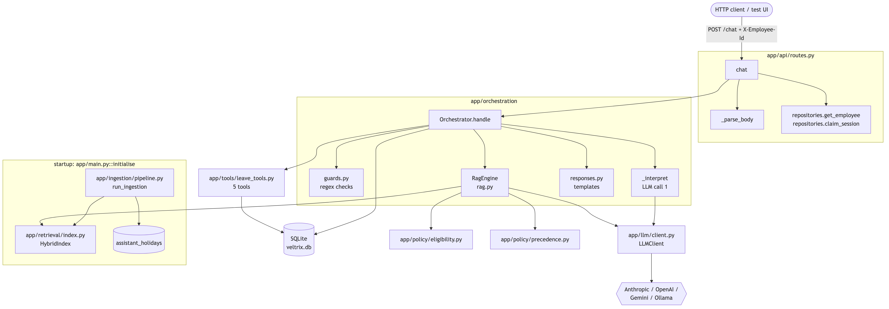
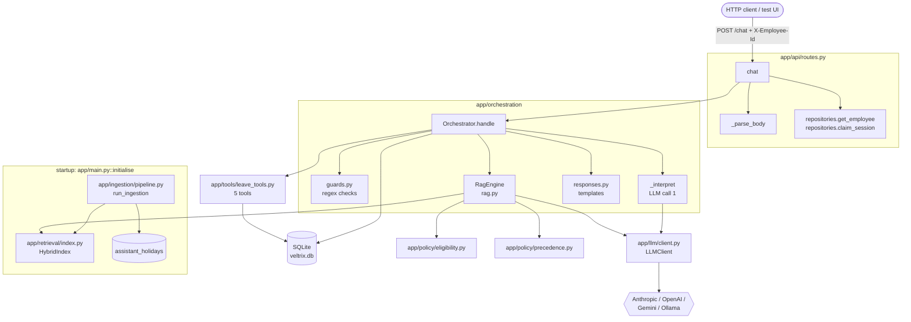
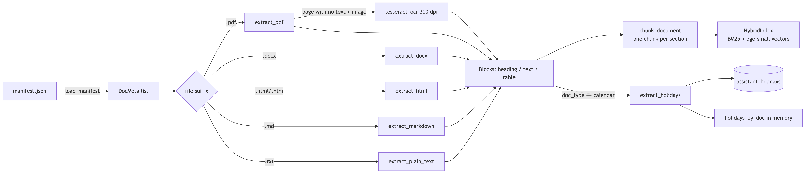
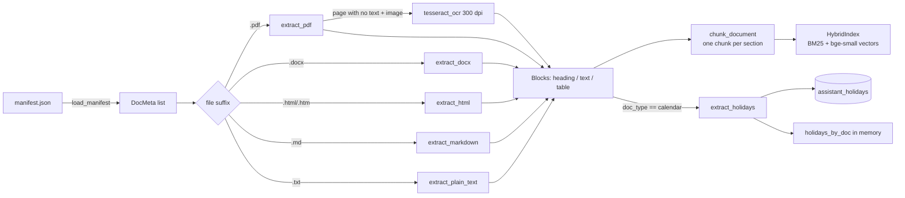
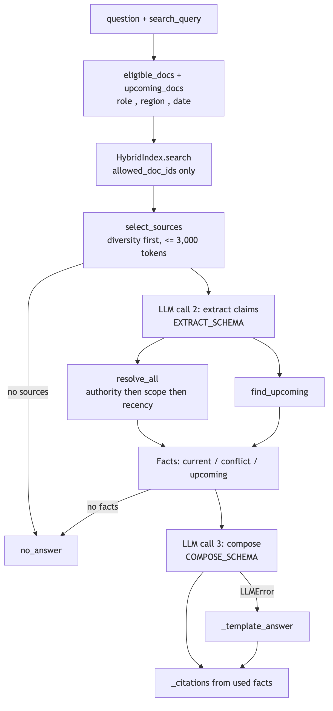
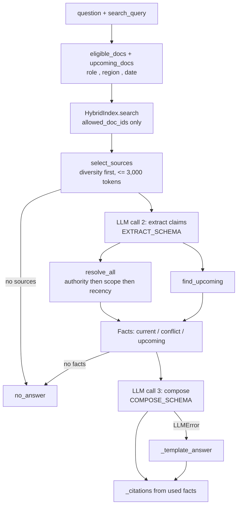
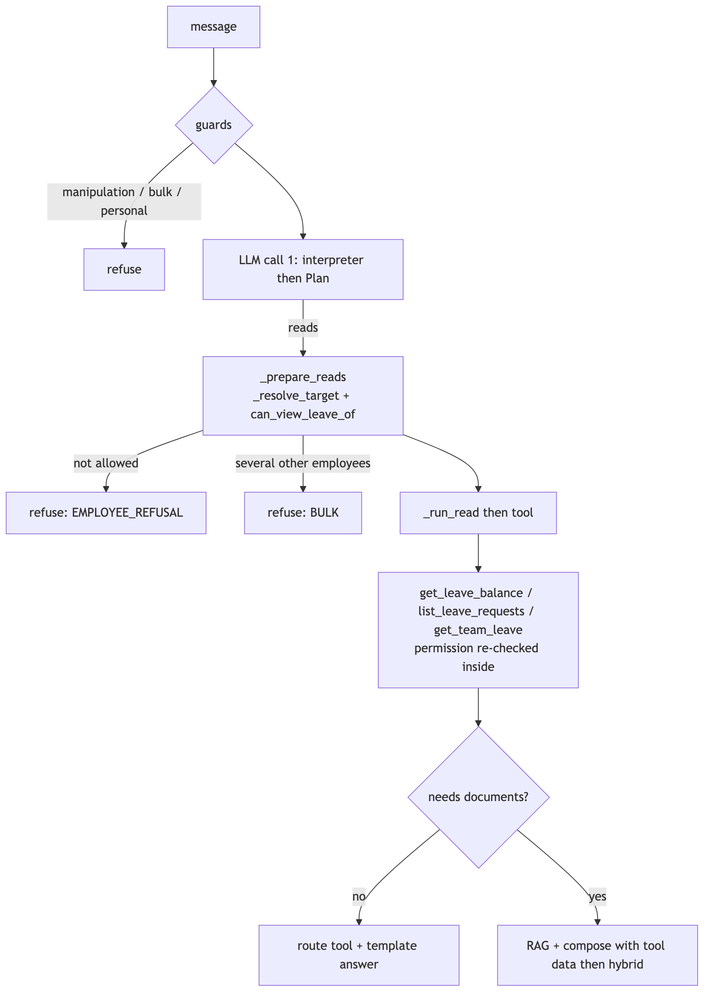
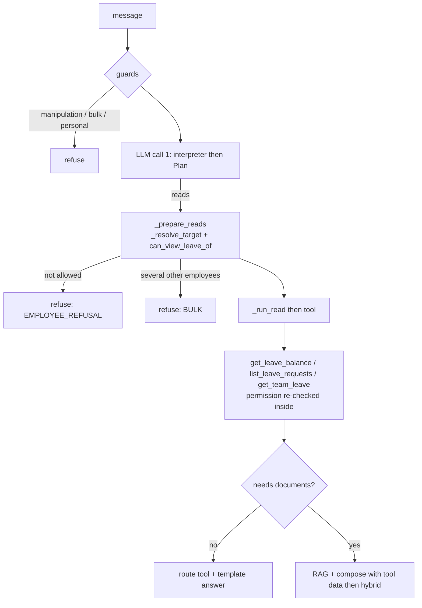
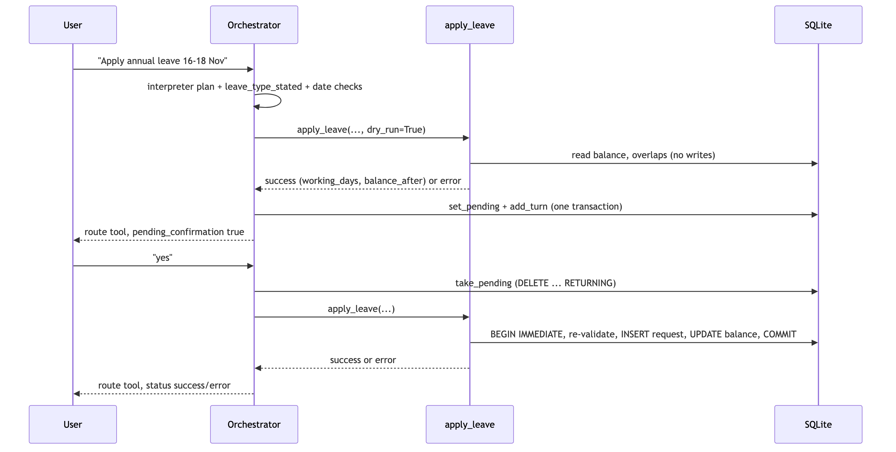
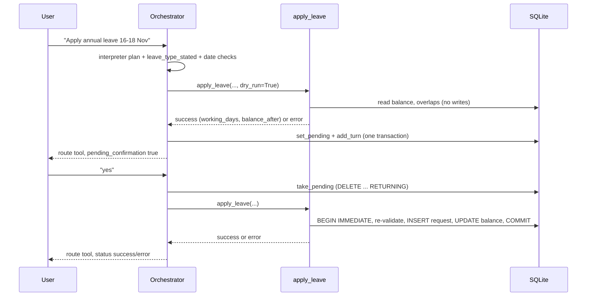

# Architecture

This page explains the components of the HR Assistant and how they fit together. For the
step-by-step path of individual requests, see [END_TO_END_FLOW.md](END_TO_END_FLOW.md).

## 1. The big picture

The service is a single FastAPI process with one chat endpoint It does two kinds of work:

- **Answering policy questions** from 30 HR documents (retrieval-augmented generation, "RAG").
- **Reading and changing leave data** in SQLite through five tools.

The central design decision is **"the LLM reads and writes; code decides"**. The LLM is used for three
language tasks: understanding the message, extracting facts from document excerpts, and writing the final
answer. Everything that must be correct or secure is in plain Python:

- who the requester is
- which documents they may read
- which document wins a conflict
- whether a leave request is valid
- what the database contains

Diagram source (Mermaid)

## 2. Components

### 2.1 HTTP layer: `app/api/routes.py`

| | |
|---|---|
| **Purpose** | Implements `POST /chat`, `GET /health` and the optional test UI at `GET /`. |
| **Input** | Raw HTTP request: `X-Employee-Id` header and a JSON body. |
| **Processing** | `_parse_body` validates the body (size ≤ 64 KB, `session_id` ≤ 200 chars, `message` ≤ 4,000 chars, no lone surrogates). `repositories.get_employee` resolves the requester. `repositories.claim_session` binds the session. The orchestrator then runs in a worker thread (`_HANDLER_POOL`), guarded by `asyncio.wait_for(asyncio.shield(...))`. |
| **Output** | The JSON response from Section 9 of the task, or `400` / `401` / `403` / `503` / `500` with `{"detail": ...}`. |
| **Dependencies** | `app/state.py::STATE` (readiness flag, orchestrator), `app/db`. |
| **Failure scenarios** | Ingestion not finished → `503`. Handler exceeds `_handler_timeout()` (29 s by default) → HTTP 200 `clarify` answer, the request's cancel flag is set and any pending proposal for the session is deleted. Unexpected exception → `500 {"detail": "internal error"}`. |

The header is checked before the body, so a request with both problems gets `401`. Details:
[API_REFERENCE.md](API_REFERENCE.md).

### 2.2 Startup and readiness: `app/main.py`, `app/state.py`

| | |
|---|---|
| **Purpose** | Build everything the service needs, then flip `/health` to `200`. |
| **Input** | `Settings` from `app/config.py::get_settings()` (environment variables). |
| **Processing** | `lifespan` starts `initialise()` in a background thread named `ingestion`. `initialise` calls `verify_and_migrate`, loads employee names and emails into the PII scrubber (`NAMES.load`, `load_known_emails`), runs `run_ingestion`, builds the LLM client with `build_llm_client`, and creates the `Orchestrator`. |
| **Output** | `STATE.ready = True`, or `STATE.failed = True` if anything raised. |
| **Failure scenarios** | Missing assessment tables or a broken manifest → `STATE.failed`, so `/health` stays `503 {"status": "error"}`. An LLM client that can't be built is **not** fatal: the service starts, and chat requests degrade to a `clarify` answer. |

### 2.3 Ingestion: `app/ingestion/`

| | |
|---|---|
| **Purpose** | Turn the corpus into searchable chunks and a holiday table, from scratch at every start. |
| **Input** | `MANIFEST_PATH` (the only source of metadata) and the files in `CORPUS_DIR`. |
| **Processing** | `pipeline.load_manifest` validates each entry into a `DocMeta`. `pipeline.extract_document` calls the format extractor: `extract_pdf` (PyMuPDF; Tesseract OCR for image-only pages), `extract_docx`, `extract_html`, `extract_markdown`, `extract_plain_text`. `chunker.chunk_document` builds one chunk per section. For `calendar` documents, `holidays.extract_holidays` reads the dates. |
| **Output** | A `KnowledgeBase` (docs, chunks, `HybridIndex`, `holidays_by_doc`, `holiday_names`, `IngestionReport`); rows in `assistant_holidays`. |
| **Dependencies** | PyMuPDF, python-docx, BeautifulSoup, pytesseract + the Tesseract binary, tiktoken, fastembed (optional). |
| **Failure scenarios** | A malformed manifest entry is skipped and logged. A missing, corrupt, empty or out-of-folder file is recorded in `report.errors`, and ingestion continues. If the embedding model is unavailable, retrieval falls back to BM25 only. |

Details: [RAG_PIPELINE.md](RAG_PIPELINE.md).

### 2.4 Retrieval: `app/retrieval/index.py`

| | |
|---|---|
| **Purpose** | Score chunks against a query, **only within the documents the requester is allowed to use**. |
| **Input** | Queries plus `allowed_doc_ids`. |
| **Processing** | `HybridIndex.search` computes BM25 (statistics over the allowed chunks only, via `_stats`) and cosine similarity with `FastEmbedder` (BAAI/bge-small-en-v1.5), then fuses the two rankings with reciprocal rank fusion. Relative cut-offs drop weak matches. |
| **Output** | A ranked list of `ScoredChunk`. |
| **Failure scenarios** | Embedding failure → lexical-only, with a warning. No allowed documents → empty list, which leads to `no_answer`. |

### 2.5 Policy rules: `app/policy/`

| Module | Responsibility |
|---|---|
| `eligibility.py` | `eligible_docs` (role, region and date filter) and `upcoming_docs` (readable and for the region, but not yet effective). |
| `precedence.py` | `resolve_rule` applies authority → scope → recency; `disagree` / `same_value` decide whether values conflict; `find_upcoming` finds upcoming changes. |
| `calendar.py` | `choose_calendars` picks the applicable holiday calendar; `working_days` counts Monday–Friday days that aren't holidays. |

These are pure functions with no I/O, which is why they are unit-tested directly
(`tests/unit/test_precedence.py`, `tests/unit/test_working_days.py`).

### 2.6 LLM access: `app/llm/`

| | |
|---|---|
| **Purpose** | One interface (`LLMClient.complete_json`) over four providers, with the corpus-token budget enforced. |
| **Input** | System prompt, user text, a JSON schema, and `corpus_blocks` (the only channel for document-derived text). |
| **Processing** | Counts the tokens of `corpus_blocks` with tiktoken `cl100k_base` (`tokens.count_tokens`). If they exceed 3,000 it raises `CorpusBudgetExceeded` without sending. Otherwise it wraps the blocks in `<documents>…</documents>`, calls the provider in `_LLM_POOL` with a hard wall-clock limit, parses the JSON (`parse_json_object`) and validates it against the schema (`schema_violation`). |
| **Output** | A `dict` matching the schema, or `LLMError`. |
| **Providers** | `AnthropicProvider` (structured output via `output_config.format`, `effort`, optional refusal fallback); `OpenAIProvider` (also used for `ollama` through `OLLAMA_BASE_URL`); `GeminiProvider` (AI Studio key, Vertex express key, or Vertex with gcloud credentials; retries plus fallback models). |
| **Failure scenarios** | Timeout, refusal, truncated output, invalid JSON or a schema mismatch all raise `LLMError`, and callers degrade (see [END_TO_END_FLOW.md §6](END_TO_END_FLOW.md#workflow-6-failure-handling)). |

### 2.7 Orchestration: `app/orchestration/`

| Module | Responsibility |
|---|---|
| `orchestrator.py` | `Orchestrator.handle` runs one turn through a LangGraph `StateGraph` (`build_graph`). Nodes call the agents; edge functions (`_route_pending`, `_route_plan`, `_route_after_reads`) pick the path; `route_contract` (`_enforce_route_contract`) keeps the route rules. Persistence stays in `handle`. |
| `rag.py` | `RagEngine.select_sources`, `gather_facts`, `compose`. |
| `guards.py` | Regex checks: `is_manipulation`, `is_bulk_request`, `is_personal_data_request`, `is_confirmation`, `is_rejection`, `leave_type_stated`; plus `date_context` for date resolution. |
| `responses.py` | Fixed messages (`EMPLOYEE_REFUSAL` lives in `security/access.py`) and templates for tool answers. |

Details: [AGENT_AND_TOOLS.md](AGENT_AND_TOOLS.md).

### 2.8 Tools: `app/tools/leave_tools.py`

`get_leave_balance`, `list_leave_requests`, `get_team_leave`, `apply_leave`, `cancel_leave`. Each one takes
a `ToolContext` (connection, requester, today, documents and holidays) and returns a `ToolResult`. Their
permission checks are inside the tool. Details: [AGENT_AND_TOOLS.md](AGENT_AND_TOOLS.md#3-the-five-tools).

### 2.9 Data access: `app/db/`

`database.py` handles connections, `write_transaction` (`BEGIN IMMEDIATE`) and the added `assistant_*`
tables. `repositories.py` holds every SQL statement, all parameterised. Details:
[DATABASE_AND_DATA_MODEL.md](DATABASE_AND_DATA_MODEL.md).

### 2.10 Security and logging: `app/security/`, `app/logging_setup.py`

`access.py` holds the role table. `pii.py` does email masking and name/email/phone scrubbing.
`logging_setup.py` provides JSON logs with `PiiScrubFilter`. Details:
[SECURITY_AND_PRIVACY.md](SECURITY_AND_PRIVACY.md) and [LOGGING_AND_DEBUGGING.md](LOGGING_AND_DEBUGGING.md).

## 3. Diagrams

### 3.1 Document ingestion and indexing

Diagram source (Mermaid)

### 3.2 RAG retrieval and response generation

Diagram source (Mermaid)

### 3.3 Agentic tool execution

Diagram source (Mermaid)

The LLM never calls a tool directly. It returns a plan (`ROUTER_SCHEMA`), code checks the plan, and code
calls the tool. Document text never reaches the interpreter, so a document can't trigger a tool.

### 3.4 Leave application and confirmation

Diagram source (Mermaid)

## 4. How the parts interact during one request

1. FastAPI receives the request on the event loop; `chat` hands the work to a thread from `_HANDLER_POOL`.
2. That thread opens **one SQLite connection** (`database.connection`), shared by identity lookup, session
   handling, tools and turn storage.
3. `Orchestrator.handle` makes 0–3 LLM calls through `LLMClient`. Each call runs on another thread
   (`_LLM_POOL`) so it can be abandoned on timeout.
4. The `KnowledgeBase` (index, chunks, holidays) is read-only shared memory, built once at startup.
5. The turn ends with one write transaction that stores the turn history and, for proposals, the pending
   action.
