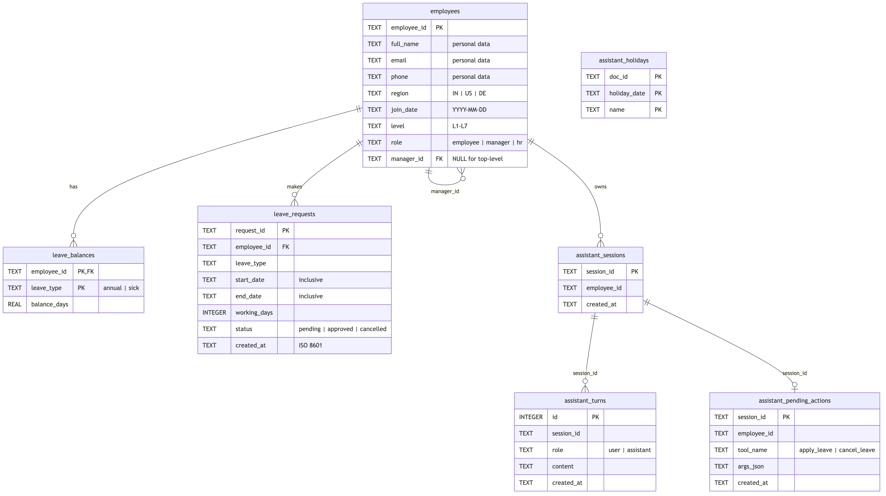
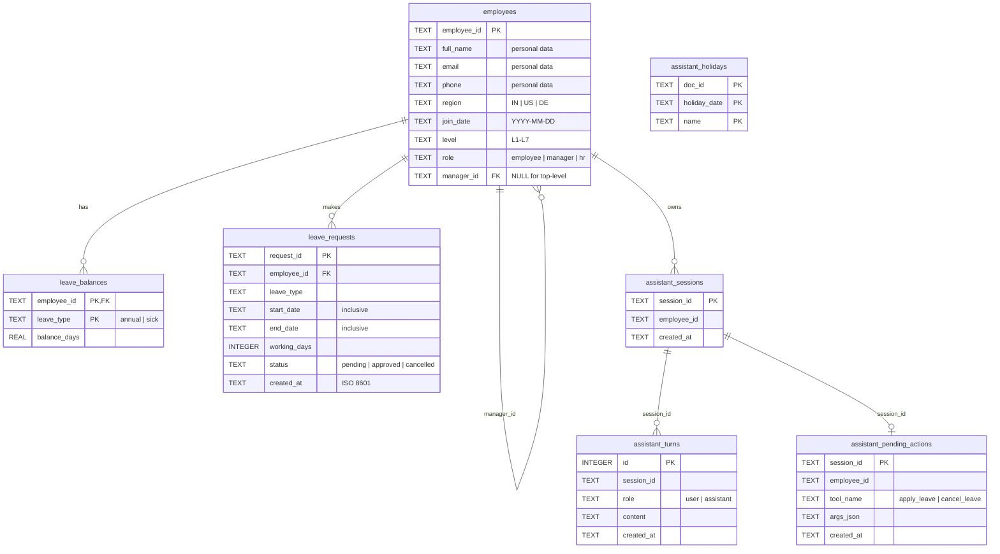

# Database and data model

## 1. Technology and location

- **SQLite**, a single file at `DB_PATH` (default `./data/veltrix.db`; `/app/data/veltrix.db` in Docker).
- Accessed with Python's `sqlite3` through `app/db/database.py` and `app/db/repositories.py`.
- Connections use `isolation_level=None` (transactions are explicit), `busy_timeout = 10000` ms and
  `foreign_keys = ON`.
- The assessment's three tables are never altered. `verify_and_migrate` checks they exist, then creates
  this service's own `assistant_*` tables and indexes with `CREATE … IF NOT EXISTS`.

## 2. Schema

Diagram source (Mermaid)

The `assistant_*` tables declare no foreign keys; the relationships above are logical.

### Assessment tables (read-only schema)

| Table | Key | Meaning |
|---|---|---|
| `employees` | `employee_id` | One row per employee. `manager_id` points to another employee; direct reports are the rows whose `manager_id` equals a manager's ID. |
| `leave_balances` | (`employee_id`, `leave_type`) | **Current remaining** balance. Days for existing pending and approved requests have already been subtracted. |
| `leave_requests` | `request_id` | One row per request; `working_days` is stored when the request is created. |

### Added tables

| Table | Written by | Purpose |
|---|---|---|
| `assistant_sessions` | `claim_session` | Session → owning employee (for `403`). |
| `assistant_turns` | `add_turn` | Conversation history; the interpreter reads the last 6 (`recent_turns`). |
| `assistant_pending_actions` | `set_pending` / `take_pending` | At most one write proposal per session. |
| `assistant_holidays` | `replace_holidays` (at every ingestion) | Holiday dates extracted from calendar documents. Tools use the in-memory copy (`KnowledgeBase.holidays_by_doc`); this table is for inspection. |
| `assistant_tickets` | `insert_ticket`, `update_ticket`, `touch_ticket` (via `app/tools/ticket_tools.py`) | HR support tickets: `ticket_id` (`TKT-` + 8 hex), owner `employee_id`, `category`, `priority` (`low`/`normal`/`high`/`urgent`), `subject`, `description`, `status` (`open`/`in_progress`/`resolved`/`closed`), `assignee_id`, timestamps. Never purged by retention. |
| `assistant_ticket_events` | `add_ticket_event` | Audit trail per ticket: `created`, `comment`, `status` (`old -> new`), `assigned`, with author and time. |

Indexes added: `idx_assistant_turns_session (session_id, id)`, `idx_leave_requests_employee
(employee_id, status)`, `idx_employees_manager (manager_id)`, `idx_assistant_tickets_employee (employee_id,
status)`, `idx_assistant_tickets_status (status, assignee_id)`, `idx_assistant_ticket_events_ticket
(ticket_id, id)`.

## 3. Domain values

| Concept | Values | Enforced in |
|---|---|---|
| Role | `employee`, `manager`, `hr` (an unknown role reads `all` only) | `access.py` |
| Leave type | `annual`, `sick` | `leave_tools.LEAVE_TYPES` |
| Request status | `pending`, `approved`, `cancelled` | `leave_tools.STATUSES` |
| Leave year | 2026 | `leave_tools.LEAVE_YEAR` |

Lifecycle: `apply_leave` creates `pending`. Approval is out of scope, but `approved` rows exist in the
data. `cancel_leave` moves `pending` or `approved` (start date after today) to `cancelled`.

## 4. Balance management

| Event | Change | Function |
|---|---|---|
| Apply (confirmed) | `balance_days -= working_days` | `apply_leave` → `adjust_balance(-days)` |
| Cancel (confirmed) | `balance_days += working_days` | `cancel_leave` → `adjust_balance(+days)` |
| Read | none; future accrual is never added | `get_balances` |

`adjust_balance` raises if no row was updated, which rolls back the transaction.

## 5. Transaction boundaries

| Operation | Transaction |
|---|---|
| Apply | `BEGIN IMMEDIATE` → `_validate_apply` → `insert_request` → `adjust_balance` → `COMMIT` |
| Cancel | `BEGIN IMMEDIATE` → `_validate_cancel` → `set_request_status` (conditional) → `adjust_balance` → `COMMIT` |
| End of turn | `BEGIN IMMEDIATE` → optional `set_pending` → two `add_turn` → `COMMIT` |
| Holiday refresh | `BEGIN IMMEDIATE` → `DELETE FROM assistant_holidays` → inserts → `COMMIT` |
| Session claim, `take_pending` | single autocommit statements (atomic on their own) |

Any exception inside `write_transaction` triggers `ROLLBACK`.

## 6. Session persistence

Sessions, turns and pending proposals live in the database, so they survive restarts. Nothing expires; a
new `session_id` starts a new conversation. Running against a fresh copy of the database starts with no
sessions.

## 7. Data handling notes

- `data/` is gitignored. Running the service locally **writes** to `data/veltrix.db` (turns, sessions,
  confirmed leave). Use a copy for experiments; the tests always use temporary copies.
- This documentation intentionally contains no rows from the employee table.
